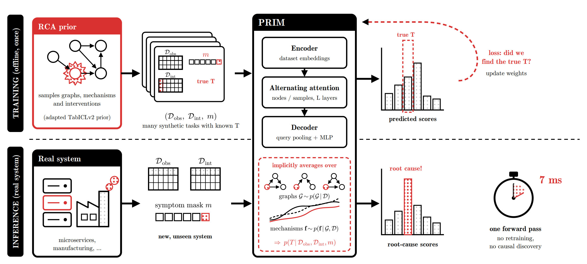
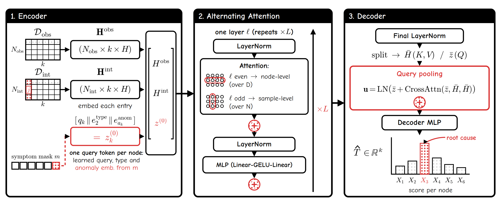

# PRIM: Meta-Learned Bayesian Root Cause Analysis

[](https://openreview.net/forum?id=edcYZi5wbN)
[](https://opensource.org/licenses/MIT)




PRIM (**P**rior-fitted **R**oot cause **I**dentification with **M**eta-learning) is a zero-shot
root cause analysis (RCA) model. It is a transformer neural process trained as a prior-fitted
network (PFN) on synthetic structural causal models (SCMs), and frames RCA as Bayesian inference
over a prior of causal models. Given paired observational and interventional (anomalous) data and
a known symptom node, PRIM outputs a single forward-pass posterior over which node was the root
cause — no causal graph, causal discovery, or retraining at test time.

This README covers everything needed to reproduce the experiments in the paper: installation,
minimal runnable examples (no external dataset needed), the full evaluation suite mapped to each
figure/table, and training from scratch.



**Figure.** PRIM-NeuralProcess architecture. `K`: number of nodes; `N`: number of samples in the
sequence (observational + interventional + the query token); `z_k^(0) = [q_k ‖ e_2^type ‖
e_{a_k}^anom]`: learned per-node query token, with `a_k = m_k` if the optional symptom mask `m` is
given, else a fixed "not provided" index; "+": residual (skip) connection; `z̄, H̄`: query/samples
after the final layer norm; `u`: per-node summary produced by QueryPooling; `T̂ ∈ ℝ^k`: output
logits.

## Citation

If you use PRIM in your work, please cite:

```bibtex
@inproceedings{lohse2026prim,
  title={{PRIM}: Meta-Learned Bayesian Root Cause Analysis},
  author={Christopher Lohse, Anish Dhir, Amadou Ba, Bradley Eck, Marco Ruffini and Jonas Wahl},
  booktitle={The Fortieth Annual Conference on Neural Information Processing Systems},
  year={2026},
  url={https://openreview.net/forum?id=edcYZi5wbN}
}
```

## Installation

**Requirements:** Python 3.12–3.13, [uv](https://github.com/astral-sh/uv).

```bash
curl -LsSf https://astral.sh/uv/install.sh | sh
uv sync
```

This creates a `.venv/` virtualenv and installs `prim` in editable mode. All scripts are run via
`uv run` from the project root — no manual path setup needed.

**To also run baseline comparisons** (Traversal, CIRCA, RCD, ε-diagnosis, BARO, ...), install the
optional baselines group. Baseline *implementations* come from the vendored PetShop and RCAEval
repos (see External Datasets below); this only installs their Python dependencies. Due to a
version conflict in `sfr-pyrca`'s metadata, it's installed separately with `--no-deps` and needs
`setuptools<81` (dropped by `setuptools>=81`) — neither is tracked by `uv sync`, so a bare
`uv sync` silently strands both. **Always use this script**, including after pulling changes or
re-syncing for any other reason:

```bash
bash scripts/install_baselines.sh
```

and use `uv run --no-sync` (not a bare `uv run`) for anything using these baselines afterwards.

## Quickstart

Two examples that need **no external dataset** — everything is generated on-the-fly from the
synthetic prior. Both finish in well under a minute.

**1. Load a checkpoint and run one inference pass:**

```python
import torch
from prim.model.prim_neural_process import PRIMNeuralProcess

model = PRIMNeuralProcess(
    embedding_size=160, num_attention_heads=8,
    mlp_hidden_size=512, num_layers=6,
    max_nodes=100, dropout=0.0,
)
ckpt = torch.load("Finalmodels/FinalPRIML.pt", map_location="cpu")
model.load_state_dict(ckpt)
model.eval()

# Dummy inputs: batch=1, 10 real nodes (padded to max_nodes=100), 50 obs samples, 20 int samples
B, K, MAX_NODES, T_obs, T_int = 1, 10, 100, 50, 20
obs_data    = torch.zeros(B, T_obs, MAX_NODES); obs_data[:, :, :K] = torch.randn(B, T_obs, K)
int_data    = torch.zeros(B, T_int, MAX_NODES); int_data[:, :, :K] = torch.randn(B, T_int, K)
target_mask = torch.zeros(B, MAX_NODES); target_mask[0, 0] = 1.0  # symptom node

with torch.no_grad():
    logits = model(obs_data, int_data, target_mask, n_nodes=K)
    root_cause = logits[0, :K].argmax().item()

print(f"Predicted root cause node: {root_cause}")
```

**2. Reproduce Figure 2** (three-node confounder/mediator, GP + NN, Recall@1 vs. `n_obs`/`n_int`):

```bash
bash scripts/launch_threenode_eval.sh Finalmodels/FinalPRIMS.pt 10 20
```

Arguments: `<checkpoint> <max_nodes> <n_episodes> [font_size]`. With `n_episodes=20` this finishes
in under a minute and writes `results/threenode_combined_obs.pdf` / `_int.pdf` (Figure 2a/2b). For
the full paper reproduction, omit `n_episodes` (default 200).

## External Datasets

Three external repos are used. PetShop and CausRCA below must be manually cloned into the project
root (they are gitignored, not part of this repository); RCAEval does not need cloning — it
installs automatically as a regular dependency (see its own subsection below).

### PetShop (Table 1, Appendix E.5)

Provides the dataset and the graph-based baselines (Traversal, CIRCA, counterfactual attribution).

```bash
git clone https://github.com/amazon-science/petshop-root-cause-analysis petshop-root-cause-analysis-main
```

```bibtex
@InProceedings{pmlr-v236-hardt24a,
  title     = {The PetShop Dataset — Finding Causes of Performance Issues across Microservices},
  author    = {Hardt, Michaela and Orchard, William Roy and Blöbaum, Patrick and
               Kirschbaum, Elke and Kasiviswanathan, Shiva},
  booktitle = {Proceedings of the Third Conference on Causal Learning and Reasoning},
  editor    = {Locatello, Francesco and Didelez, Vanessa},
  pages     = {957--978}, year = {2024}, volume = {236},
  series    = {Proceedings of Machine Learning Research}, month = {01--03 Apr}, publisher = {PMLR},
  url       = {https://proceedings.mlr.press/v236/hardt24a.html}
}
```

### CausRCA (Table 1, Appendix E.6)

```bash
git clone https://github.com/causalgraph/causRCA causRCA-main
```

```bibtex
@Article{Mehling2026,
  author  = {Mehling, Carl Willy and Pieper, Sven and Lüke, Tobias and Döbelt, Julius and Ihlenfeldt, Steffen},
  journal = {Procedia CIRP}, year = {2026}, volume = {139}, pages = {114--120},
  title   = {Enabling Joint Benchmarking of Automated Root Cause Analysis and Causal Discovery in Manufacturing Using the causRCA Dataset},
  issn    = {2212-8271}, month = {jan}, series = {13th CIRP Global Web Conference},
  doi     = {10.1016/j.procir.2025.09.010},
  url     = {https://www.sciencedirect.com/science/article/pii/S221282712500976X}
}
```

### RCAEval (baseline dependency only — Figure 3's BARO curve)

Not itself an evaluated benchmark in this paper. `prim/evaluation/rcaeval_baro.py` uses RCAEval's
own `e2e.baro` implementation as the "BARO" baseline curve in Figure 3 / Appendix E.3. Unlike
PetShop and CausRCA above, **no manual clone is needed** — it installs automatically as a regular
(git-sourced) dependency via `bash scripts/install_baselines.sh` (see Installation above).

```bibtex
@inproceedings{pham2025rcaeval,
  title     = {Rcaeval: A benchmark for root cause analysis of microservice systems with telemetry data},
  author    = {Pham, Luan and Zhang, Hongyu and Ha, Huong and Salim, Flora and Zhang, Xiuzhen},
  booktitle = {Companion Proceedings of the ACM on Web Conference 2025}, pages = {777--780}, year = {2025}
}
```

Install baseline dependencies (RCAEval, sfr-pyrca, and the rest) with
`bash scripts/install_baselines.sh` (see Installation above).

## Model Architecture

PRIM is a **prior-fitted transformer neural process** (Section 5.2 / Appendix C / Figure 1 of the
paper), implemented in `prim/model/prim_neural_process.py` as `PRIMNeuralProcess`. Its design is
inspired by the causal-structure-induction architecture of Ke et al. (2023) and the causal
meta-learning approach of Dhir et al. (2025b).

1. **Encoder**: observational and interventional samples are each encoded into per-node
   embeddings — a data-type-specific linear value projection, concatenated with a fixed
   sinusoidal node-identity code, a learned sample-type tag (obs/int), and a learned anomaly
   tag from the optional binary symptom mask.
2. **Alternating-attention transformer**: a learned per-node query token is appended to the
   sequence, and `L=6` pre-norm transformer blocks refine it via attention alternating between
   the `K` nodes and the `N` samples (obs + int + query), so obs and int samples attend to each
   other bidirectionally at every layer.
3. **QueryPooling decoder**: an attentive neural-process-style readout maps the evolved query
   against the evolved samples to a per-node summary, decoded by a two-layer MLP into per-node
   root-cause logits.

```bibtex
@inproceedings{ke2023learning,
  author    = {Ke, Nan Rosemary and Chiappa, Silvia and Wang, Jane X. and Bornschein, Jorg and
               Goyal, Anirudh and Rey, Melanie and Weber, Theophane and Botvinick, Matthew and
               Mozer, Michael Curtis and Rezende, Danilo Jimenez},
  title     = {Learning to Induce Causal Structure},
  booktitle = {International Conference on Learning Representations}, year = {2023},
  url       = {https://openreview.net/forum?id=hp_RwhKDJ5}
}
```

The causal meta-learning approach this follows (Dhir et al., 2025b):

```bibtex
@inproceedings{Dhir2507,
  author    = {Dhir, Anish and Diaconu, Cristiana and Lungu, Valentinian Mihai and Requeima, James and
               Turner, Richard E. and van der Wilk, Mark},
  title     = {Estimating Interventional Distributions with Uncertain Causal Graphs through Meta-Learning},
  booktitle = {The Thirty-ninth Annual Conference on Neural Information Processing Systems}, year = {2025},
  url       = {https://openreview.net/forum?id=IQlcfc40Ja}
}
```

Two trained sizes are provided in `Finalmodels/` (Appendix D, Table D.2–D.3):

| Checkpoint | Nodes trained on | Params | Used for |
|---|---|---|---|
| `Finalmodels/FinalPRIMS.pt` (PRIM-S) | `K ∈ [2, 10]` | 1,928,409 | Fig. 2 (confounder/mediator), Appendix E.1 (multi-RCA), E.2 (finetuning ablation) |
| `Finalmodels/FinalPRIML.pt` (PRIM-L) | `K ∈ [17, 100]` | 1,939,209 | Fig. 3 / Appendix E.3 (node-size scaling), E.4 (inference time), PetShop, CausRCA |

## Running Evaluations

All scripts `cd` to the project root automatically and write outputs (PDFs/PNGs/CSVs) to
`results/`. Each maps to one paper figure or table.

| Paper item | Script | Needs external data? |
|---|---|---|
| Fig. 2 — three-node confounder/mediator | `bash scripts/launch_threenode_eval.sh <ckpt>` | No |
| Fig. 3 / App. E.3 — Recall@1 vs. node count (with baselines) | `bash scripts/launch_prior_eval.sh <ckpt>` | No (baselines optional, `install_baselines.sh`) |
| App. E.1 — multi-root-cause (MAP@2) | `bash scripts/launch_multi_rca_eval.sh <ckpt>` | No |
| App. E.2 — finetuning ablation (far/near OOD) | `bash scripts/launch_ablation_finetuning.sh <ckpt>` | No |
| App. E.4 / Table E.1 — inference time | `bash scripts/launch_timing_benchmark.sh <ckpt>` and `uv run python prim/evaluation/benchmark_inference_laptop.py` | No |
| Table 1 / App. E.5 — PetShop | `bash scripts/launch_petshop_eval.sh` | PetShop repo |
| Table 1 / App. E.6 — CausRCA (ε-diag, RCD, traversal, CIRCA baselines) | `bash scripts/launch_causrca_eval.sh` and `bash scripts/launch_causrca_baselines.sh` | CausRCA repo |
| Table 1 — PetShop's Baro / TimeRank columns | `uv run python prim/evaluation/test_extra_baselines.py --benchmarks petshop --methods baro timerank` | PetShop + CausRCA repos |
| *(supplementary, not in the paper tables)* — EasyRCA/MicroCause/CausalRCA/MSCRED/RUN on PetShop and CausRCA | `uv run python prim/evaluation/test_extra_baselines.py --benchmarks petshop causrca` | PetShop + CausRCA repos |

`test_extra_baselines.py`'s `timerank` method calls causRCA-main's own `TimeRecency_BaselineUnsupervisedRCA`
(the real TimeRank algorithm from Mehling et al., 2026) via an adapter that converts PetShop's
continuous metrics into the discrete change-event log that class expects — see the module docstring
for the change-detection threshold (`TIMERANK_Z_THRESHOLD`, default 2.0 std-devs from the
observational baseline). **This threshold is a real design choice and the resulting number is
sensitive to it** — z∈{1.5, 2.0, 2.5, 3.0} gave top-3 recall of {0.06, 0.15, 0.17, 0.17}
respectively in testing, so re-check this against your intended methodology before reporting it.
(An earlier version of this file used RCAEval's unrelated `cloudranger` baseline as a stand-in for
TimeRank; `cloudranger` is still available as its own, correctly-labeled, entry if useful.)

**Run PetShop and CausRCA on a laptop CPU** — both need only the vendored dataset repos (no GPU),
and each finishes in under two minutes:

```bash
bash scripts/launch_petshop_eval.sh    # ~1m45s, reproduces Table 1's PetShop top-3 recall (0.79)
bash scripts/launch_causrca_eval.sh    # ~1m30s, reproduces Table 1's CausRCA MAP@3 (Sub 0.62, Full 0.27)
```

Both were verified end-to-end on a MacBook (CPU only, no CUDA/MPS needed) and reproduce the paper's
numbers to within rounding.

**Train from scratch** (single- or multi-GPU, auto-detected; trains both PRIM-S and PRIM-L
configurations per Appendix D depending on GPU count):

```bash
bash scripts/launch_meta_training.sh small   # PRIM-S: K in [2,10], 40 epochs
bash scripts/launch_meta_training.sh large   # PRIM-L: K in [17,100], 160 epochs
```

Optionally pass a second argument to override the epoch count:
`bash scripts/launch_meta_training.sh small 20`.

**Generate a pre-built synthetic dataset** (instead of generating on-the-fly during training):

```bash
uv run python prim/data/generate_dataset.py
```

## Decoupled Plotting

Evaluation scripts save results to CSVs in `results/` and can regenerate plots from those CSVs
without re-running the experiment — useful for changing font size or styling.

```bash
# Figure 2 (three-node combined GP+NN)
uv run python prim/plots/plot_threenode_combined.py \
    --font_size 14 --out_obs results/threenode_combined_obs.pdf --out_int results/threenode_combined_int.pdf

# Figure 3 / Appendix E.3
uv run python prim/plots/plot_prior_results.py --csv results/prior_eval_results_large.csv --font_size 14

# Appendix E.1 (multi-RCA)
uv run python prim/evaluation/test_multi_rca.py --plot_from_csv --csv results/multi_rca_results.csv --font_size 14

# Appendix E.2 (finetuning ablation), all sweep figures at once with consistent styling
uv run python prim/plots/plot_all_errorbar.py --font_size 14
```

The `--font_size` flag is supported across all evaluation and plot scripts (default 12).

## Prior and Data Generation

Training data is generated on-the-fly from a synthetic prior of SCMs — no fixed dataset needed
(Section 5.1 / Appendix B). `prim/data/tabicl_rca_prior.py` adapts the TabICLv2 prior (Qu et al.,
2026) to RCA: sparse random DAGs (Erdős–Rényi, Barabási–Albert, bipartite), mixed structural
mechanisms (MLP, tree, linear, Gaussian process), a calibrated set of intervention types
(weight-change, additive shift, hard do-intervention, noise inflation — see Appendix B.4 for how
intervention-strength ranges were calibrated via a two-sample MMD test), and optional AR(1)
temporal structure. `prim/data/dag_generator_simplified.py` provides the underlying DAG/SCM
sampling and intervention machinery; `notebooks/prior_mmd_calibration.ipynb` reproduces the MMD
calibration in Appendix B.4 / Table B.1.

```bibtex
@inproceedings{qu2026tabiclv,
  author    = {Qu, Jingang and Holzmüller, David and Varoquaux, Gaël and Le Morvan, Marine},
  title     = {TabICLv2: A Better, Faster, Scalable, and Open Tabular Foundation Model},
  booktitle = {Forty-third International Conference on Machine Learning}, year = {2026},
  url       = {https://openreview.net/forum?id=SxsyLjIfWB}
}
```

## Repository Structure

```
RootCauseMetaLearning/
├── prim/                              # Installable Python package
│   ├── model/
│   │   └── prim_neural_process.py     # PRIMNeuralProcess (Fig. 1 / Sec. 5.2 / Appendix C)
│   ├── data/
│   │   ├── tabicl_rca_prior.py        # TabICLv2-derived RCA prior (Sec. 5.1 / Appendix B)
│   │   ├── dag_generator_simplified.py    # DAG/SCM sampling, interventions, noise
│   │   ├── prior_mmd_calibration.py       # MMD intervention-strength calibration (Appendix B.4)
│   │   ├── generate_dataset.py            # Pre-build a training dataset
│   │   ├── pytorch_loader.py              # PyTorch Dataset wrapper for pickled data
│   │   └── nn_prior_config.json           # Neural-net equation family config
│   ├── training/
│   │   ├── train_meta_rca.py              # Single-GPU training
│   │   └── train_meta_rca_multigpu.py     # Multi-GPU DDP training
│   ├── evaluation/
│   │   ├── test_threenode_synthetic.py    # Fig. 2 — confounder/mediator
│   │   ├── test_prior_eval.py             # Fig. 3 / App. E.3 — node-size scaling vs. baselines
│   │   ├── test_multi_rca.py              # App. E.1 — multi-root-cause (MAP@2)
│   │   ├── ablation_finetuning.py         # App. E.2 — far-OOD (sinusoidal) finetuning ablation
│   │   ├── ablation_finetuning_weak.py    # App. E.2 — near-OOD (weak NN) finetuning ablation
│   │   ├── benchmark_inference_laptop.py  # Table E.1 — inference time on CPU/MPS
│   │   ├── test_petshop.py                # Table 1 / App. E.5 — PetShop
│   │   ├── test_causrca.py                # Table 1 / App. E.6 — CausRCA (PRIM)
│   │   ├── test_causrca_baselines.py      # Table 1 / App. E.6 — CausRCA baselines
│   │   ├── test_extra_baselines.py        # Supplementary baselines (not in the paper tables):
│   │   │                                    EasyRCA/MicroCause/CausalRCA/MSCRED/RUN/BARO on PetShop,
│   │   │                                    same + BARO on CausRCA
│   │   ├── rcaeval_baro.py                # BARO baseline shim (used by test_prior_eval.py and
│   │   │                                    test_extra_baselines.py)
│   │   ├── node_filtering.py, simple_baselines.py  # shared utilities
│   ├── finetuning/
│   │   └── finetune_causrca.py            # Finetuning on synthetic CausRCA-like data
│   └── plots/
│       ├── plot_threenode_combined.py     # Figure 2 from CSVs
│       ├── plot_prior_results.py          # Figure 3 from CSVs
│       ├── plot_all_errorbar.py           # All error-bar figures, consistent styling
│       └── benchmark_inference_time.py    # Appendix E.4 timing figure vs. baselines
├── scripts/                           # bash launchers, one per table/figure (see above)
├── results/                           # All output PDFs, PNGs, and CSVs
├── Finalmodels/                       # Pretrained checkpoints: FinalPRIMS.pt, FinalPRIML.pt
├── notebooks/prior_mmd_calibration.ipynb  # Appendix B.4 reproduction
├── causRCA-main/                      # CausRCA benchmark data (clone separately)
├── petshop-root-cause-analysis-main/  # PetShop benchmark data + baselines (clone separately)
├── RCAEval-main/                      # BARO baseline dependency for Fig. 3 (clone separately)
└── pyproject.toml
```
